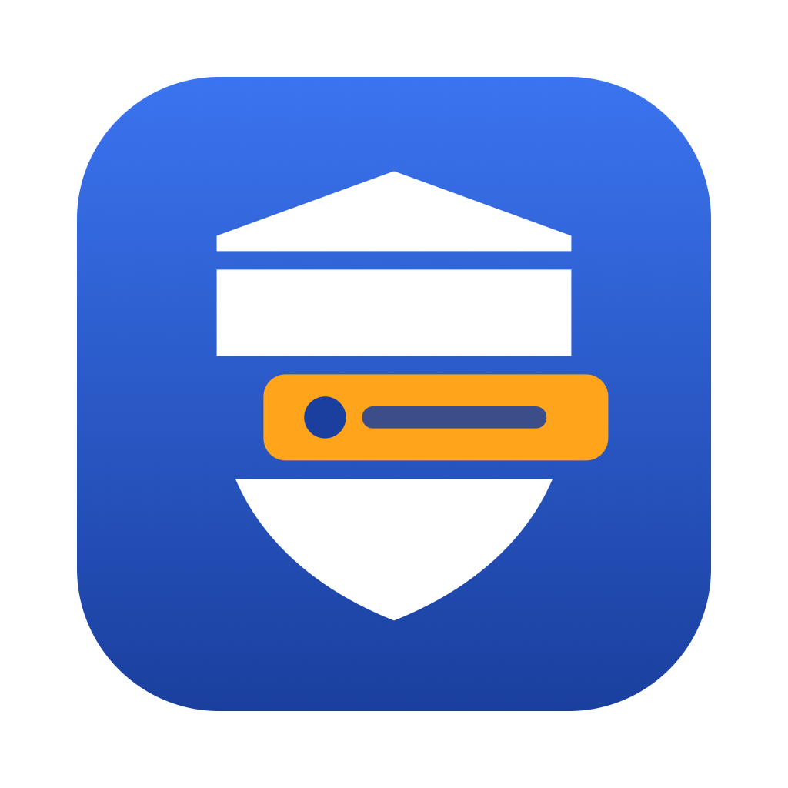

# Patch Gap

A macOS app that queries Jamf Pro and lists the apps installed across your fleet that aren't covered by Patch Management, recommending the Combined Definition title to add.

**Version:** 0.2.0
**Owner:** Russell Collis

## Features
- Reads every installed app from computer inventory (`/api/v1/computers-inventory`, APPLICATIONS section) and groups it by app across computers.
- Compares it with your configured Patch Management titles (`/api/v2/patch-software-title-configurations`) and patch policies (`/api/v2/patch-policies`).
- **Status** for every app:

  | Status | Meaning |
  | --- | --- |
  | Patched | An enabled patch policy (or an enabled App Installer deployment) updates the app |
  | Reporting only | A patch title exists, so versions are reported, but no enabled patch policy updates the app |
  | Not patched – title available | No patch title yet; Jamf offers one (or an App Installer) |
  | Not patched – no Jamf title | Jamf has no patch title or App Installer for the app |

- **Definition** for every app — **always prefer the Combined Definition**:

  | Definition | Meaning |
  | --- | --- |
  | Combined Definition | The configured patch title is a Combined Definition |
  | Version-specific – Combined available | The configured title is version-specific (e.g. `1Password 8`); switch to the Combined Definition shown under "Recommended patch title" |
  | Standard (no Combined offered) | The configured title is the only one Jamf offers |
  | Combined available / Standard available | Not configured yet; shows which kind you can add |
  | App Installer | Patched through a Jamf App Catalog App Installer |

  Jamf marks Combined Definitions in the publisher (e.g. `AgileBits (Combined Definition)`) and sometimes in the title name; both are checked, as well as the catalogue entry the configured title points to.
- Checks the Jamf patch catalogue (Classic API `patchavailabletitles`, read as XML because the Classic JSON shape is inconsistent) for titles that can be added.
- Checks the Jamf App Catalog App Installers (`/api/v1/app-installers/titles`) for apps that can be deployed and patched, matching on bundle ID. Apps with an App Installer deployment count as patched. This is the same list published at [App Installers Software Titles](https://learn.jamf.com/r/en-US/jamf-app-catalog/App_Installers_Software_Titles).
- Shows when the App Installer title list was last scanned, with the title count and a link to Jamf's published list. The date is kept between launches.
- Filters: Not patched / Reporting only / Not Combined / Patched / All, search, hide Apple apps, only `/Applications`.
- Exports the current view to CSV.

## Getting started
Open `Untitled Project.xcodeproj` in Xcode and build the **MyApp** scheme (product: `Patch Gap.app`).

Create a Jamf Pro API role and client (Settings > System > API roles and clients) with these privileges:

| Privilege | Used for |
| --- | --- |
| Read Computers | Installed apps from inventory |
| Read Patch Management Software Titles | Configured patch titles |
| Read Patch Policies | Active vs reporting-only titles |
| Read Patch Internal Sources | Jamf patch catalogue |
| Read App Installers | Jamf App Catalog titles and deployments |

A user account with the same privileges also works.

## Usage
1. Open Patch Gap and enter your Jamf Pro URL, client ID and client secret (the secret is stored in your keychain).
2. Choose **Save and Refresh**. Large fleets take a little while because inventory is paged 200 computers at a time.
3. Review the **Not patched** view. "Recommended patch title" is the Patch Management title to add; "App Installer available" is a Jamf App Catalog alternative.
4. Review **Reporting only** for titles that need a patch policy.
5. Check **Not Combined** for patch titles that should be swapped to the Combined Definition.

> **Jamf title lists last checked:** 19 November 2026, against [App Installers Software Titles](https://learn.jamf.com/r/en-US/jamf-app-catalog/App_Installers_Software_Titles) (about 374 titles) and [Patch Management Software Titles](https://learn.jamf.com/r/en-US/jamf-app-catalog/Patch_Management_Software_Titles) (126 Combined Definitions). The app itself reads the live lists from Jamf Pro on every refresh; the in-app footer shows when that last happened.

Matching uses normalised names (case, punctuation, version numbers and years removed) for patch titles, and bundle IDs for App Installers. Apps whose names differ greatly from the Jamf title name may show as "no Jamf title".

## License
MIT © 2026 Russell Collis — see [LICENSE](LICENSE).
